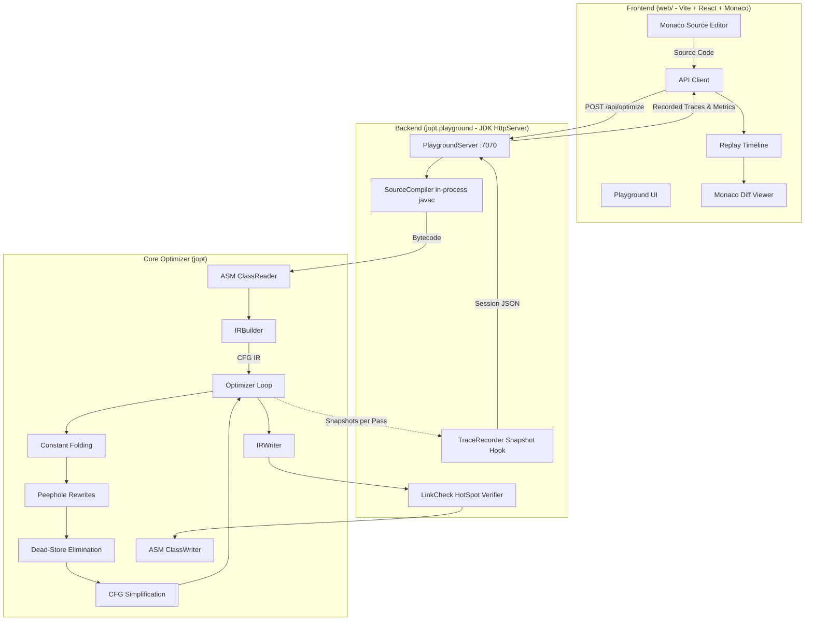

# jopt — Java Bytecode Optimizer & Interactive Playground

`jopt` is a Java bytecode optimizer and interactive compilation playground. It analyzes compiled Java bytecode (`.class`, `.jar`, or directory trees), constructs a stack-based control-flow graph (CFG) Intermediate Representation (IR), and applies classic iterative compiler optimizations to produce smaller, cleaner bytecode that preserves exact execution semantics.

The project pairs a high-performance bytecode optimization engine with an interactive web playground: write Java source in a browser IDE, compile in-process with `javac`, watch every pass run step-by-step with real CFG and bytecode diffs, inspect pass counters and documentation, and verify generated classes using HotSpot's bytecode verifier.

```
       Original Java Source
                │
                ▼ (javac --release 21)
       Raw Bytecode (.class)
                │
                ▼ (jopt IRBuilder)
       Control-Flow Graph (CFG IR)
                │
         ┌──────┴────────────────────────────────────┐
         │  Iterative Optimization Pipeline          │
         │  Round 1..N (until fixed-point):          │
         │  1. Constant Folding (fold)               │
         │  2. Peephole Rewrites (peephole)          │
         │  3. Dead-Store Elimination (dse)          │
         │  4. CFG Simplification (cfg)              │
         └──────┬────────────────────────────────────┘
                │
                ▼ (jopt IRWriter)
       Optimized Bytecode (.class)
                │
                ▼ (HotSpot LinkCheck)
       JVM Verifier Verification
```

---

## Table of Contents

- [Features](#features)
- [Architecture](#architecture)
- [Optimization Passes](#optimization-passes)
- [Prerequisites & Platform Support](#prerequisites--platform-support)
- [Quick Start](#quick-start)
- [Configuration](#configuration)
- [Interactive Playground](#interactive-playground)
- [CLI Reference](#cli-reference)
- [Testing & Quality Verification](#testing--quality-verification)
- [Project Layout](#project-layout)
- [Security & Trust Boundaries](#security--trust-boundaries)
- [Known Limitations](#known-limitations)
- [Troubleshooting](#troubleshooting)
- [Contributing](#contributing)
- [License](#license)

---

## Features

- **Cooperative Optimization Passes**: Iterative, fixed-point loop executing Constant Folding, Peephole Rewrites, Dead-Store Elimination, and CFG Simplification until no further changes occur.
- **Safety First**: Every method is verified by ASM's verifier; if an optimized method does not shrink or fails verification, the original bytecode is retained. Classes are further verified using HotSpot's runtime verifier without running static initializers.
- **Interactive Web Playground**:
  - In-browser code editor powered by Monaco with syntax highlighting and instant compilation diagnostics (`javac --release 21`).
  - Pass-by-pass recorded replay showing exact IR blocks and lowered bytecode.
  - Side-by-side and unified diff viewers comparing against input or previous steps.
  - Instruction-to-source linking using Java `LineNumberTable` metadata.
  - Comprehensive metrics tracking bytecode instruction counts, code array bytes, CFG blocks, and IR instructions.
  - Pass toggle controls to isolate individual compiler transformations.
  - Full keyboard accessibility and WAI-ARIA roving-tabindex navigation.
- **Cross-Platform Compatibility**: Fully supported and verified across macOS (Apple Silicon & Intel), Linux, and Windows.
- **Stand-alone Zero-Dependency Server**: Built using JDK's built-in `com.sun.net.httpserver`, binding to loopback with DNS-rebinding protection and CORS enforcement.

---

## Architecture

The system consists of two primary modules: the Java core engine (`jopt`) and the frontend single-page application (`web/`).



---

## Optimization Passes

Optimization passes run repeatedly in rounds over each method's control-flow graph until a round executes with zero changes (reaching a fixed point), up to a safety threshold of 32 rounds:

| Pass | Name | Description | Key Rewrites |
|---|---|---|---|
| `fold` | **Constant Folding** | Forward dataflow analysis tracking constants across locals and operand stack slots. | Constant arithmetic, boolean branch folding (`if (false)`), constant switch elimination. |
| `peephole` | **Peephole Rewrites** | Window rewrites inside basic blocks. | Push/pop elimination, algebraic identities (`x + 0`, `x * 1`, `x & 0`), strength reduction (`x * 8` → `x << 3`), `i = i + 1` → `iinc`, redundant load/store removal. |
| `dse` | **Dead-Store Elimination** | Backward liveness analysis over local variable slots. | Unread variable stores converted to `pop` (cancelled by peephole), dead `iinc` removal. |
| `cfg` | **CFG Simplification** | Structural graph clean-up on basic blocks. | Jump threading through empty blocks, merging blocks into sole predecessors, unreachable block deletion. |

---

## Prerequisites & Platform Support

### Supported Platforms Matrix

| Operating System | Architecture | Status | Verification Method |
|---|---|---|---|
| **macOS** | Apple Silicon (`aarch64`) | **Verified** | Local environment & Playwright E2E |
| **macOS** | Intel (`x86_64`) | **Verified** | GitHub Actions CI matrix |
| **Linux** (Ubuntu 22.04+) | `x86_64` / `aarch64` | **Verified** | GitHub Actions CI matrix |
| **Windows** (10 / 11) | `x86_64` | **Verified** | GitHub Actions CI matrix (`gradlew.bat`) |

### Runtime Requirements

- **Java Development Kit (JDK)**: Version 21 (LTS). A full JDK (not JRE) is mandatory because the playground invokes `javax.tools.JavaCompiler`.
- **Node.js**: Version 20+ (LTS) or 22+ (LTS) with `npm`.
- **Git**: Configured with LF line endings (handled automatically via `.gitattributes`).

---

## Quick Start

### 1. Clone the Repository

```sh
git clone https://github.com/Amirtha-yazhini/jopt.git
cd jopt
```

### 2. Build the Application

On macOS / Linux:
```sh
./gradlew installDist
cd web && npm ci && npm run build && cd ..
```

On Windows (Command Prompt / PowerShell):
```cmd
.\gradlew.bat installDist
cd web
npm ci
npm run build
cd ..
```

### 3. Launch the Interactive Playground

```sh
# On macOS / Linux
./gradlew playground

# On Windows
.\gradlew.bat playground
```

Open your browser to `http://localhost:7070/`.

---

## Configuration

Configuration is managed via environment variables or command-line arguments. An example configuration template is available in [`.env.example`](.env.example).

| Variable | Default | Purpose |
|---|---|---|
| `PORT` | `7070` | Port for the backend playground server |
| `JOPT_PORT` | `7070` | Alternative port environment variable |
| `JOPT_BACKEND` | `http://localhost:7070` | Target URL used by Vite dev proxy during frontend development |
| `JAVA_HOME` | System default | Path to JDK 21 installation directory |
| `VITE_PORT` | `5173` | Local development port for the Vite server (`web/`) |

---

## Interactive Playground

### Interface Layout

1. **Top Bar**: Product identity, current experiment status indicator, theme toggle (Dark/Light), keyboard shortcuts dialog, and session reset.
2. **Source Panel (Left)**:
   - Example selector (pre-loaded with 10 real compiler transformation demonstrations).
   - Java code editor with real-time `javac` diagnostics.
   - Individual pass toggle switches (`fold`, `peephole`, `dse`, `cfg`).
   - Primary **Optimize** button with character budget tracking.
3. **Pipeline Panel (Middle)**:
   - Method selector dropdown.
   - Size reduction bar chart (`SizeChart`) displaying instructions per step.
   - Step-by-step stage tree grouped by round, showing change deltas and fixed-point completion.
   - Timeline replay controller with step controls, scrubber, and playback speed (1×–4×).
4. **Transformation Inspector (Right)**:
   - Step header with method name, step number, and pass explanation.
   - Transformation cards documenting pass counters and rewrite rules.
   - Real-time size comparison metrics (bytecode instructions, code bytes, IR blocks, IR instructions).
   - Monaco Diff Viewer supporting side-by-side or inline view, Bytecode vs. IR representations, and diff against input or previous steps.
5. **Bottom Drawer**:
   - **Problems**: Clickable compilation diagnostics that jump directly to source lines.
   - **Summary**: Method reduction totals and class file size metrics.
   - **Classes**: HotSpot bytecode verification status for every generated class.
   - **Decisions**: Decision log documenting why methods were accepted or kept unchanged.

### Keyboard Shortcuts

| Shortcut | Action |
|---|---|
| `⌘ + Enter` / `Ctrl + Enter` | Run optimizer on current source (works inside code editor) |
| `→` / `←` | Step to next / previous optimization stage |
| `Home` / `End` | Jump to first / last optimization stage |
| `Space` | Play or pause timeline replay |
| `?` | Open keyboard shortcuts help modal |
| `Tab` / `Shift + Tab` | Navigate between controls |
| `Arrow Keys` (inside tabs/radios) | Roving-tabindex navigation between tabs and segmented views |

---

## CLI Reference

The CLI is built into `build/install/jopt/bin/jopt` (or `jopt.bat` on Windows) via `./gradlew installDist`:

### Optimize Bytecode
```sh
# Optimize a JAR, directory, or single .class file
jopt optimize app.jar -o app-optimized.jar --report report.html

# Provide external classpath dependencies for frame computation
jopt optimize app.jar -o app-optimized.jar --cp lib/depA.jar:lib/depB.jar

# Disable specific optimization passes
jopt optimize app.jar -o app-optimized.jar --disable fold,dse
```

### Inspect Changes
```sh
# Compare a method before and after optimization side-by-side in the terminal
jopt show app.jar com.example.Calculator compute
```

### Verify Output Classes
```sh
# Link every class into a fresh classloader and run HotSpot's verifier
jopt verify app-optimized.jar
```

### Run Demonstration Suite
```sh
# Optimize the naively written demo application, verify it, run both versions, and output an HTML report
./gradlew demo
```

---

## Testing & Quality Verification

JOpt maintains a multi-layered automated test suite covering JVM correctness, differential execution, golden outputs, unit tests, and Playwright end-to-end testing:

### 1. Java Test Suite (75 tests)
```sh
# Runs all differential, golden, real-world, and HTTP server tests
./gradlew test
```
- **Differential Testing**: 26 sample algorithms executed 2,000 times each across edge-case inputs comparing unoptimized vs optimized outputs.
- **Golden Bytecode Tests**: Verifies exact expected instructions are emitted for known idioms.
- **Real-World Verification**: Optimizes the complete ASM library JAR (1,300+ classes), verifies all classes pass HotSpot, and validates byte-for-byte reproducibility.
- **Server API Tests**: Verifies HTTP loopback restrictions, header checks, query parsing, and error shapes.

### 2. Frontend Unit & Integration Tests (36 tests)
```sh
cd web
npm test
```
- Tests state reducer transitions, step indexing, replay timer, stale result detection, and metric formatters using real backend response fixtures.

### 3. Static Type Checking & Linting
```sh
cd web
npm run typecheck
npm run lint
```

### 4. End-to-End Playwright Tests (7 journeys)
```sh
cd web
npm run e2e
```
- Tests complete user journeys against the real running backend, including pass navigation, replay playback, compile error handling, retry mechanisms, outdated input handling, and responsive layout behavior.

---

## Project Layout

```
jopt/
├── .github/workflows/ci.yml       # Cross-platform GitHub Actions CI matrix
├── .env.example                   # Environment configuration template
├── .gitattributes                 # Cross-platform line ending normalization
├── .nvmrc                         # Node version specification (20 LTS)
├── build.gradle                   # Root Gradle build script
├── gradlew / gradlew.bat          # Cross-platform Gradle wrappers
├── package.json                   # Root convenience scripts
├── progress.md                    # Detailed engineering log & checklist
│
├── src/main/java/jopt/            # Core Java implementation
│   ├── Main.java                  # CLI and entrypoint driver
│   ├── ir/                        # IR basic blocks, instructions, reader/writer
│   ├── analysis/                  # Constant propagation and liveness analyses
│   ├── opt/                       # fold, peephole, dse, cfg passes & OptimizerTrace
│   ├── io/                        # ClassFiles reader/writer, LinkCheck verifier
│   ├── report/                    # HTML report generator
│   └── playground/                # In-process javac wrapper & HTTP server
│
├── src/demo/java/demo/            # Sample application optimized by ./gradlew demo
├── src/test/java/jopt/            # JUnit 5 test suite (75 tests)
│
└── web/                           # Interactive playground frontend
    ├── package.json               # Frontend dependencies & scripts
    ├── vite.config.ts             # Vite configuration with /api proxy
    ├── playwright.config.ts       # Cross-platform E2E configuration
    ├── e2e/                       # Playwright browser journey tests
    └── src/
        ├── App.tsx                # Main workspace layout & panel resizing
        ├── api/                   # Typed API client, types & response validators
        ├── state/                 # Session reducer, derived selectors, metrics
        ├── components/            # Header, SourcePanel, PipelinePanel, Inspector, BottomPanel
        ├── monaco/                # Monaco editor loader & custom JVM grammar
        ├── styles/                # CSS design system (tokens.css, app.css)
        └── ui/                    # Accessible controls, vocabulary, keyboard shortcuts
```

---

## Security & Trust Boundaries

- **No Untrusted Execution**: Submitted user code is compiled via `javax.tools.JavaCompiler` and analyzed in memory. Classes are loaded only with `Class.forName(name, false, loader)` to trigger bytecode verification; **static initializers (`<clinit>`) and methods are never executed**.
- **Loopback Enforcement**: The playground server binds strictly to `127.0.0.1` and enforces that the incoming `Host` header matches loopback to prevent DNS rebinding attacks.
- **CORS Protection**: The server requires a custom header (`X-Jopt-Client`) on all state-modifying requests (`POST`), preventing cross-origin requests from arbitrary websites.
- **Resource Limits**: Requests are capped at 64 KiB source code size, 20-second timeout, and max 2 concurrent optimization runs.

---

## Known Limitations

- **Intraprocedural Only**: Optimizations operate strictly on single methods. Cross-method inlining and interprocedural analysis are not performed.
- **Replay Rather Than Live Incremental**: Optimization is completed synchronously on the backend in milliseconds; the frontend replays the recorded pass-by-pass snapshots.
- **Code Size vs. Runtime Speed**: Bytecode reductions do not guarantee faster execution on modern HotSpot JVMs, as the C2 JIT compiler already performs many of these transformations at runtime. The benefits are smaller JAR sizes, reduced memory footprint, faster cold startup, and enhanced execution on environments without aggressive JIT compilers (e.g. Android ART/D8, GraalVM Native Image, embedded JVMs).

---

## Troubleshooting

### "Unsupported class file major version" with Gradle
Gradle 8.10.2 requires JDK 21 or earlier to execute the build. If your machine's default JDK is newer (e.g. JDK 25 or 26), set `JAVA_HOME` to a JDK 21 installation:
```sh
export JAVA_HOME=/path/to/jdk-21
./gradlew test
```

### "Address already in use" on port 7070
If port 7070 is already in use by another process, launch the playground on a custom port:
```sh
./gradlew playground -PplaygroundPort=7080
# or
jopt playground --port 7080
```

### "Permission denied: ./gradlew" on Unix/macOS
Ensure the Gradle wrapper has the executable bit enabled:
```sh
chmod +x gradlew
```

---

## Contributing

1. Fork and clone the repository.
2. Verify that JDK 21 and Node 20+ are installed.
3. Run `./gradlew test` to ensure all Java tests pass.
4. Run `cd web && npm ci && npm test && npm run lint` to verify frontend tests.
5. Create a descriptive feature branch (`git checkout -b feature/my-feature`).
6. Ensure existing tests pass and add new tests covering your changes.
7. Submit a pull request.

---

## License

This project is open source and available under the terms of the [Apache License, Version 2.0](https://www.apache.org/licenses/LICENSE-2.0).
